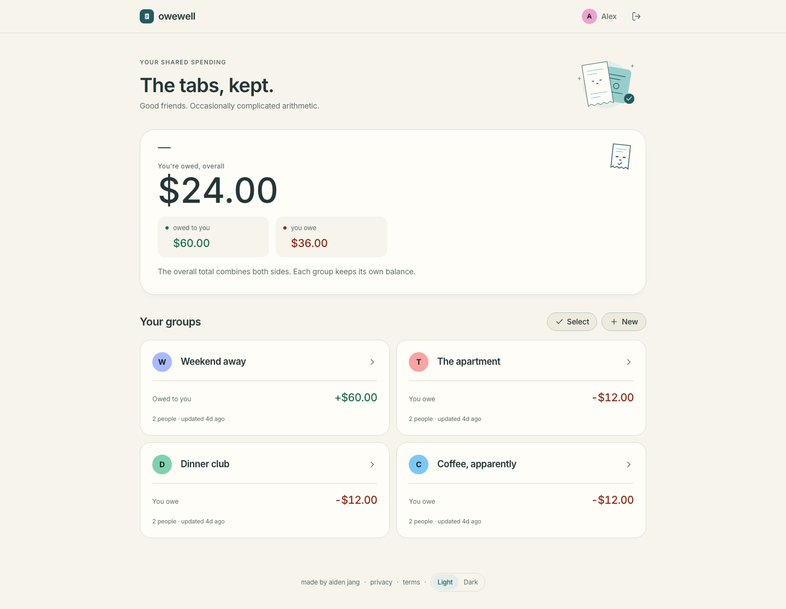

# owewell

Split bills, see who owes whom and record payments with friends.

**[Use owewell](https://owewell.aidenjang.com)**



_Dashboard preview using browser-only review fixtures._

Built with TypeScript, React, Vite, Tailwind CSS, Hono, Cloudflare Workers,
D1, Drizzle and Durable Objects. Part of the [shared Accounts platform](https://github.com/aiden-jang/auth/blob/main/PLATFORM.md).

## What it does

- Split a bill without an account, including unequal shares and different payers.
- Keep groups with account holders and name-only placeholders. Share a read-only
  view and let someone connect an existing seat to their account.
- Add simple or itemized expenses, dates, categories and notes. Edits retain
  revision history; soft deletion supports undo.
- Suggest settlement transfers and record partial, manual or over payments.
  owewell records payments; it does not send money.
- Queue supported changes offline with idempotency and edit-conflict handling.
  Queued changes remain visibly separate from confirmed balances.
- Follow live group changes, archive groups and choose warm or dark appearance.

Money uses integer cents. The server computes and validates saved expense shares;
settlement suggestions use a greedy algorithm, without promising a mathematical
minimum. See [Decisions](DECISIONS.md) for the constraints behind these choices.

## Run locally

Use the latest Node 22 release, at least 22.22.2, and the pnpm version pinned in
[package.json](package.json). The supported Node ranges match the DOM test runtime. Bare `pnpm` must also
resolve to the pinned version because workspace scripts call it.

```sh
corepack enable pnpm
corepack pnpm install --frozen-lockfile
corepack pnpm --filter @owewell/api run db:migrate:local
```

Start these in separate terminals from the repository root:

```sh
corepack pnpm run dev:api
corepack pnpm run dev:web
```

The web app runs at `http://localhost:30001`; its API proxy reaches the local
Worker at `http://localhost:34200`. The development API and web sign-in use the
local Accounts service at `http://localhost:34100`. Run that sibling service for
manual sign-in, or use the isolated browser tests below, which supply fake auth.

## Verify

```sh
corepack pnpm --filter @owewell/web exec playwright install chromium webkit
corepack pnpm run verify
```

Verification runs the repository guards, unused-code analysis, types, lint,
formatting, production build, generated-CSS checks, unit/DOM tests and browser
journeys. CI runs the same gates in the same order. Browser tests use a separate
local D1 directory and fake auth; they do not use production data.

[Quality checks](docs/quality.md) describes focused runs, browser setup, review
fixtures and checks that require a physical device.

## Repository

| Package           | Responsibility                                                              |
| ----------------- | --------------------------------------------------------------------------- |
| `packages/web`    | React interface, recovery drafts, offline outbox and API client             |
| `packages/api`    | Authenticated Worker routes, ledger services, D1 and realtime notifications |
| `packages/shared` | Dependency-free money, allocation and settlement arithmetic                 |
| `packages/core`   | Wire types, payment methods and expense categories                          |

- [Architecture](docs/architecture.md): runtime boundaries, data flow and module ownership.
- [Contributing](CONTRIBUTING.md): development, review and commit conventions.
- [Repository conventions](CONVENTIONS.md): engineering rules and ledger invariants.
- [Design](DESIGN.md): interface and accessibility decisions.
- [Deployment runbook](DEPLOY.md): the existing merge-to-main workflow and database operations.
- [Visual review evidence](docs/ui-qa/README.md): historical captures and their verification limits.

The committed [schema](packages/api/src/db/schema.ts) and
[migrations](packages/api/migrations/README.md) define the database. Apply local
migrations before developing against a changed schema. Authentication has its own
database in the Accounts service; realtime rooms notify clients to refetch D1.

## License

[MIT](LICENSE) © Aiden Jang. Font assets retain their included licenses.

Group options include **Print recap / Save PDF**. The paper layout contains saved
expenses, recorded payments, and server-provided balances. A waiting-to-save notice
keeps queued changes distinct from saved records. The browser print dialog handles
paper or PDF. Group names also identify their browser tabs.

The app manifest offers **Split a bill** and includes current phone and desktop
captures in `packages/web/public/screenshots/`. They use the public $48 example,
not a personal group. Recapture the public splitter when its layout changes.

Aggregate traffic and feature-event coverage, privacy boundaries and queries: [Analytics](docs/ANALYTICS.md).
